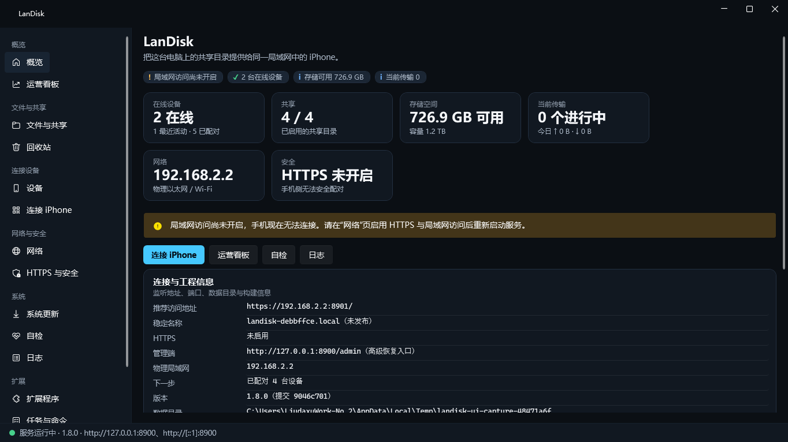
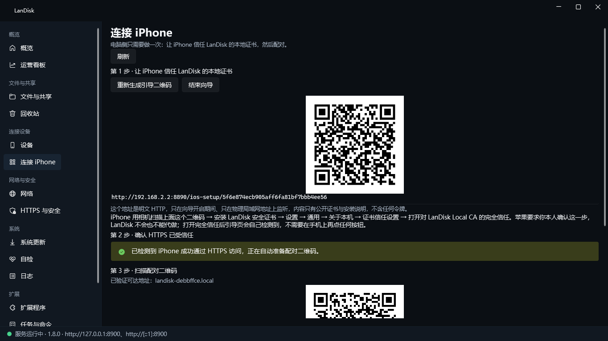
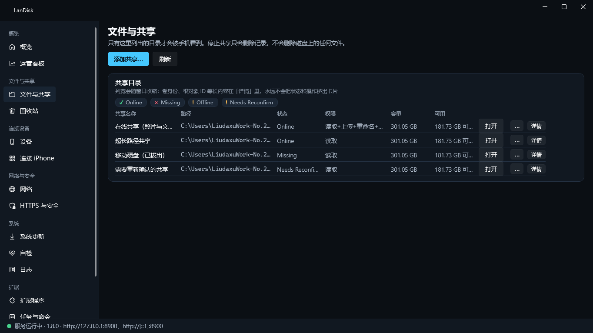
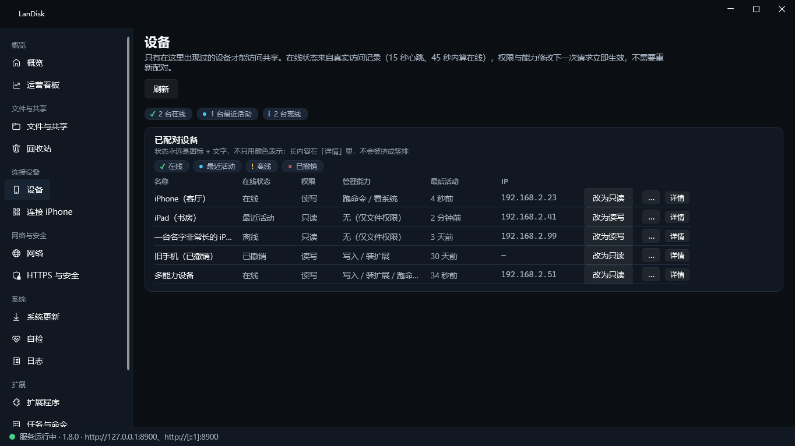
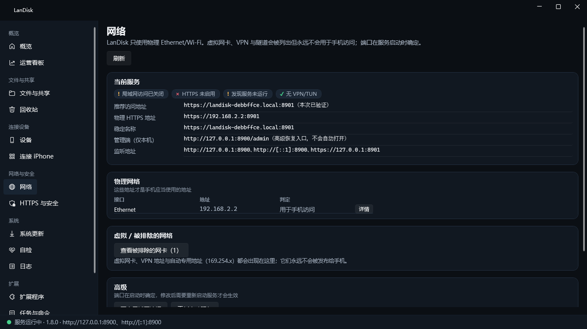

# LanDisk — Windows ↔ iPhone 局域网文件应用

[](https://github.com/Liudx069/LanDisk/actions/workflows/ci.yml)
[](LICENSE)

LanDisk 让 iPhone（或任何同一局域网内的浏览器）通过网页访问这台 Windows 电脑上**你明确授权**的
文件夹和磁盘，完成 **查看、播放、下载、上传、重命名、删除** 六项操作，并提供一套现代文件管理器的
浏览体验：多列排序、搜索与筛选、最近、收藏、列表/网格、图片缩略图、多选、批量下载 ZIP、批量删除。

- 电脑端：一个自包含的 Windows 程序。**双击 `LanDisk.exe` 即可**，托盘中常驻，本机浏览器打开管理页
  **不需要复制任何令牌**。
- 手机端：同一局域网内的网页，Safari 直接打开，可"添加到主屏幕"；首次扫码配对，之后自动登录。
- **系统更新**：管理页可以直接上传已签名的 `.lupd` 更新包，自动备份、重启、自检，
  自检不通过会**自动回滚**，并且升级不会改动端口、共享、配对设备或任何用户文件。
- 不依赖云存储、中转服务器、CDN、在线字体或任何常驻后台服务；应用本身不调用大模型。

当前版本 **1.8.0**（候选提交见 `dist/delivery/RELEASE_CANDIDATE_IDENTITY.md`），
历经 1.0（六项核心功能）→ 1.1（文件管理器体验与免令牌登录）→ 1.2（桌面应用与签名更新）→
1.4（安装器与首次运行向导）→ 1.7（界面系统、动态权限、在线状态、主题）→ 1.8（真机修复与 WiFi 移除）。

## 界面

> 截图取自 1.8.x 桌面端，1366×768、深色主题（浅色与 100%–200% 缩放同样支持）。

| 概览 | 连接 iPhone |
|---|---|
|  |  |

| 文件与共享 | 设备 |
|---|---|
|  |  |

| 网络 |
|---|
|  |

## 一分钟上手

1. 解压 `LanDisk-win-x64.zip` 到任意目录（例如 `D:\LanDisk`），或直接运行 `LanDisk-Setup.exe` 安装。
2. **双击 `LanDisk.exe`**：出现一个小窗口与托盘图标，服务开始监听 `127.0.0.1:8891`（无需控制台）。
3. 用**这台电脑**的浏览器打开 `http://127.0.0.1:8891/admin`，或在托盘菜单选「打开管理页面」，
   会直接进入（无需令牌）。
4. 在「共享」→「添加共享」里选择要开放的文件夹或移动硬盘盘符。
5. 在「网络」里开启局域网访问（推荐同时启用 HTTPS），保存后**退出并重新启动** LanDisk。
6. 在「添加设备」里生成二维码，用 iPhone 扫码完成配对（也可用 6 位短码，需在本页确认）。
7. iPhone 上用 Safari 打开 `https://<电脑局域网IP>:8892/`，会直接进入文件列表。

> **地址要固定一个**：二维码里编的是 `https://<稳定名>.local:8892`。扫码就用这个地址，手输就用 IP，
> 不要把两者混用 —— 配对凭据按主机名隔离，混用会表现为"一直要求重新配对"。
> 路由器上给这台机做 DHCP 保留，可以避免 IP 变化后手机书签失效。

不需要托盘时也可以直接运行 `LanDisk.Server.exe`（同样的服务端，无界面，便于命令行或脚本使用）。

完整步骤、HTTPS 证书在 iPhone 上的安装与信任、故障排查、移动硬盘拔插、**升级与回滚**等，见
[`docs/USER_GUIDE.md`](docs/USER_GUIDE.md)。

## 1.8.0 这一版

| 类别 | 内容 |
|---|---|
| 手机主题 | 修复"泛粉/颜色全错"：调色板是 `#AARRGGBB` 而 CSS 要 `#RRGGBBAA`，写入前统一转 `rgb()/rgba()` |
| 删除入口 | 共享开启"允许删除"后，已配对 iPhone **立即**出现删除入口（推进权限修订号，不需要重新配对） |
| WiFi | WiFi 管理从产品中**完整移除**（导航、页面、接口、手机面板、权限位），旧配置仍可读取 |
| 兼容 | 升级保留安装 id、稳定名称、根 CA、已配对设备、共享、回收站、端口与更新密钥 |

## 目录结构

```
src/LanDisk.Core           # 路径安全、卷身份、共享模型、排序/搜索、上传/回收/缩略图/批量等核心逻辑
src/LanDisk.Update         # 更新包格式、签名/校验、计划与暂存状态机（服务端与更新程序共用）
src/LanDisk.Server         # ASP.NET Core 宿主与 HTTP 接口
src/LanDisk.App            # WinForms 桌面外壳（发布为 LanDisk.exe）
src/LanDisk.Setup          # 安装器（矢量机柜视觉、首次运行、证书与防火墙）
src/LanDisk.Updater        # 独立更新程序（单文件自包含，发布到 updater/）
src/LanDisk.ExtensionHost  # 受限扩展宿主进程
src/LanDisk.Web            # React + TypeScript + Vite 前端（构建产物进入 Server/wwwroot）
tests/LanDisk.Tests        # xUnit 自动化测试
tests/samples              # 合成媒体样本（ffmpeg 生成，无任何用户数据）
tools/e2e                  # Playwright 浏览器验证（播放/预览 + 全套界面自动化）
tools/keytool              # 发布侧密钥与打包工具（不发私钥、不进发布包）
tools                      # 构建、打包、发布包冒烟验收、实机升级验收、隐私检查脚本
docs                       # 中文使用说明、构建说明、测试方案、已知限制、第三方许可、审计更正
dist/delivery              # 交付产物（运行包、源码包、更新包、SHA256 清单、报告、证据）
```

## 安全模型要点

- **默认不共享任何目录**，首次启动不监听局域网，也不会自动修改防火墙、证书信任或开机启动项。
- 本机管理端只在**真正来自回环地址且是同源页面**时自动进入；伪造 `Host`、`Origin`、
  `X-Forwarded-For`、`Sec-Fetch-Site: cross-site` 都不能获得管理员身份。局域网上的手机无法访问管理端。
- 手机只提交 `shareId` + 相对路径，永远不能提交 Windows 绝对路径；
  所有文件接口（包括缩略图、批量 ZIP、批量删除、搜索）都经过同一个解析层：拒绝 `..`、绝对路径、
  UNC、设备命名空间、ADS、保留设备名、重复百分号编码，并在打开句柄后用
  `GetFinalPathNameByHandle` 复核真实路径与卷身份。
- **批量下载 ZIP 与批量删除在选择与执行之间逐条重新校验**（卷身份 + 文件索引 + 长度 + 修改时间），
  文件被改动时拒绝并以 `CHANGED_SELECTION` 逐项说明，绝不写入与选择不一致的内容。
- **不跟随**符号链接、junction 与挂载点；文件被替换（版本令牌不匹配）或存在多个硬链接时拒绝写入。
- 新配对设备默认**只读**；共享的能力与设备的级别取交集。
- 删除是 LanDisk 自己的**可恢复回收站**；回收失败时拒绝删除，绝不退化成永久删除。
- 上传分块**严格顺序写入**，续传必须证明已接收前缀与本地文件一致，同名不静默覆盖。
- **更新只接受由内置发布公钥签名的包**；上传即校验签名与每个文件的哈希，被拒绝的包不留任何痕迹；
  安装前自动备份，自检不通过自动回滚，回滚按字节恢复程序文件与状态元数据。

## 构建

```powershell
pwsh -File tools/Build-All.ps1                 # 版本号取自 src/LanDisk.Core/LanDisk.Core.csproj
pwsh -File tools/Build-All.ps1 -Version 1.8.1  # 需要时显式覆盖
dotnet build LanDisk.slnx -c Release           # 只编译，不打包
```

首次生成签名密钥（**只在发布机上做一次，并把私钥离线保存**）：

```powershell
pwsh -File tools/New-SigningKey.ps1
```

详见 [`docs/BUILD.md`](docs/BUILD.md)。运行发布包**不需要** Node.js、Python 或 DSH。

## 测试

```powershell
dotnet test tests/LanDisk.Tests/LanDisk.Tests.csproj          # 全量单元/集成测试
pwsh -File tools/Release-SmokeTest.ps1                        # 发布包真实启动验收
pwsh -File tools/Update-ReleaseVerify.ps1                     # 发布包实机升级 + 自动回滚验收
node tools/e2e/playback-test.mjs                              # 真实浏览器播放/预览
node tools/e2e/ui-test.mjs --engine chromium                  # 真实浏览器界面自动化
node tools/e2e/ui-test.mjs --engine webkit                    # 同上，WebKit 引擎
```

测试结果、实测环境与未测项见 `dist/delivery/` 中的最终报告与 [`docs/TEST_PLAN.md`](docs/TEST_PLAN.md)。

## 已知限制（摘要）

真机 iPhone、物理移动硬盘与可信 HTTPS 未在本机验证（如实记为 `NOT_RUN`）；
不做服务器转码，能否播放取决于 iPhone 对容器与编码的支持；
应用内回收站不是 Windows 系统回收站，也不等于备份；
缩略图按需生成（列表与网格都会显示），**没有批量预生成任务**；
Playwright 的 WebKit 不等于真实 Safari；
**绑定地址失效时会自动回退到当前物理网卡**，并在网络页和日志里提示（1.8.1 起不再静默降级）；
丢失发布签名私钥后将无法再发布可被现有安装信任的更新包。
完整列表见 [`docs/KNOWN_LIMITATIONS.md`](docs/KNOWN_LIMITATIONS.md)，审计更正见
[`docs/AUDIT_CORRECTIONS.md`](docs/AUDIT_CORRECTIONS.md)。

## 环境要求

- Windows 10/11 x64，构建需要 .NET 10 SDK；运行发布包不需要任何运行时。
- 前端构建需要 Node.js 20+（仅开发时）。
- iPhone 端只用 Safari / 任意同网浏览器，不需要安装 App。

## 许可

[MIT](LICENSE)。第三方组件许可见 [`docs/THIRD_PARTY_LICENSES.md`](docs/THIRD_PARTY_LICENSES.md)
与 [`THIRD_PARTY_NOTICES.md`](THIRD_PARTY_NOTICES.md)。

## 安全

请先读 [`SECURITY.md`](SECURITY.md)：**发布签名私钥不随仓库分发**，自己打包更新前需要用
`tools/New-SigningKey.ps1` 生成一套自己的密钥；漏洞请走私密渠道报告。

## 状态

当前版本 **1.8.1**，Windows 端与手机端功能完整，自动化测试 749 项全部通过。
真实 iPhone、真实 UAC 建防火墙规则、真机视频解码等只能人工验证的项目，在交付报告里如实记为
`NOT_RUN`，没有用自动化结果冒充。

